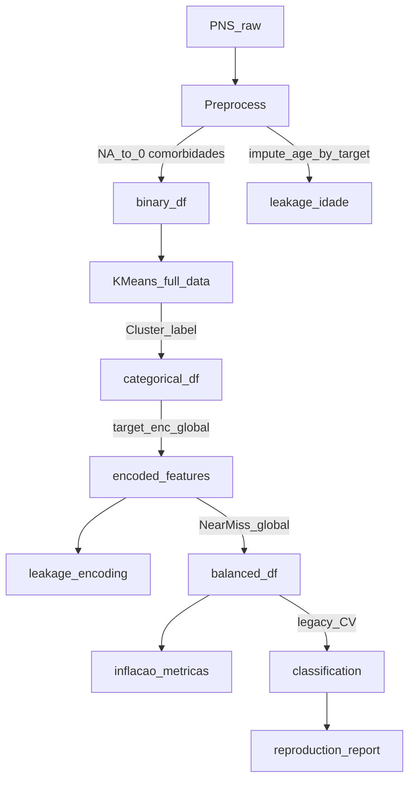

> **Arquivo histórico.** Conteúdo operacional migrado para [trajetoria.md](../trajetoria.md) (Parte 2.1 e Parte 5). Não referenciar em código ou documentação ativa.
# Auditoria metodológica — decisões com risco de indução

Registro sistemático de decisões **já implementadas** no PNS Health Research Lab cujo embasamento na monografia (TCC) é fraco, ausente ou contraditório, e cujo efeito pode **induzir viés, vazamento de informação ou leitura errada de resultados**.

**Complementa** (não substitui):

- [trajetoria.md](trajetoria.md) — narrativa e resultados oficiais
- [documentacao.md](documentacao.md) — módulos, fórmulas e configs
- [referencias/](referencias/) — ancoragem bibliográfica

Monografia: [research/monografia.pdf](research/monografia.pdf) · Showcase legado: `artifacts/showcase/pesquisa-original-legacy/`

---

## Como usar este documento

1. Leia o **resumo executivo** para priorizar itens de severidade **Alta**.
2. Consulte a seção por fase (pré-processamento → resultados) antes de redigir método, discussão ou defesa.
3. Verifique a coluna **Camada**: `legacy` = overlay `tcc_overlay.yaml` / showcase; `pns` = perfil rigoroso em `configs/profiles/pns.yaml`; `ambos` = afeta as duas trilhas.
4. Itens mitigados no default evolutivo estão também no [Apêndice B](#apêndice-b--itens-mitigados-no-perfil-evolutivo).

**Critério de inclusão:** decisão implementada + justificativa insuficiente na monografia ou divergência de boas práticas + risco interpretativo mensurável.

---

## Legenda

| Campo | Valores |
|-------|---------|
| **Severidade** | **Alta** — vazamento ou viés que pode invalidar comparação supervisionada; **Média** — distorce métricas ou perfis, mas reproduz o TCC; **Baixa** — comunicação, documentação ou escolha secundária |
| **Camada** | `legacy` · `evolutivo` · `ambos` |
| **Tipo de risco** | `viés` · `vazamento` · `inflação_métrica` · `interpretação` · `reprodutibilidade` · `documentação` |

---

## Resumo executivo

Ordenado por severidade (Alta → Baixa). Números do showcase: `reproduction_report.json` (classificação **FAIL** por métricas **acima** do TCC em +0,02 a +0,04).

| ID | Fase | Decisão (resumo) | Severidade | Camada |
|----|------|------------------|------------|--------|
| CLS-01 | Classificação | Target encoding global antes do CV (inclui `Cluster`) | Alta | legacy |
| CLS-02 | Classificação | NearMiss no dataset inteiro antes do split | Alta | legacy |
| CLU-01 | Agrupamento | K-Means no dataset inteiro; `Cluster` entra na classificação | Alta | ambos |
| PRE-03 | Pré-processamento | Imputação de idade pela média do target | Alta | legacy |
| CFG-01 | Classificação | Flag `legacy_cv` documentada mas não ligada ao código | Alta | evolutivo |
| PRE-01 | Pré-processamento | NA e não-`Sim` → `0` em comorbidades | Média | ambos |
| PRE-06 | Pré-processamento | Target composto (internação ∨ consulta) só na classificação | Média | ambos |
| CLS-03 | Classificação | Protocolo `run_legacy_cv` (grid no val, fit no tr) | Média | ambos |
| CLS-04 | Classificação | Peso amostral não usado no `fit` (legacy) | Média | legacy |
| CLS-11 | Classificação | `run_research_v2_cv` aplica NearMiss sempre (perfil `research_v2`) | Média | evolutivo |
| CON-01 | Consolidação | `FAIL` no relatório quando métrica supera o TCC | Média | legacy |
| CON-03 | Consolidação | Showcase como referência com protocolo leak-prone | Média | legacy |
| PRE-02 | Pré-processamento | Binário NA→0 vs categórico NA→-1 | Média | ambos |
| PRE-05 | Pré-processamento | Filtro adulto listwise agressivo (~69% removido) | Média | ambos |
| PRE-04 | Pré-processamento | Peso `legacy_formula` vs `V00291` | Média | legacy |
| CLU-06 | Agrupamento | `Cluster` em `target_encode_columns` | Média | legacy |
| CLS-05 | Classificação | GridSearch `f1_macro` vs métrica primária `f1_positive` | Média | ambos |
| CLS-06 | Classificação | Alias `f1` = macro no JSON de métricas | Média | ambos |
| POS-01 | Pós-modelo | `cross_analysis` no mesmo run preditivo | Média | ambos |
| DOC-01 | Documentação | Target composto sem prevalência por definição | Média | ambos |
| PRE-08 | Pré-processamento | Fusão gestacional em comorbidades | Baixa | ambos |
| PRE-07 | Pré-processamento | Estágio `impute_missing` redundante (0 células) | Baixa | ambos |
| CLU-03 | Agrupamento | PCA sem scaler (legacy) | Baixa | legacy |
| CLU-04 | Agrupamento | k=6 fixo; elbow calculado mas ignorado | Baixa | legacy |
| CLU-05 | Agrupamento | Silhouette como único PASS de clustering | Baixa | legacy |
| CLS-07 | Classificação | SVC nas tolerâncias mas desabilitado | Baixa | legacy |
| CLS-08 | Classificação | `device: cuda` no legacy | Baixa | legacy |
| CLS-09 | Classificação | Importância só no último fold | Baixa | ambos |
| CLS-10 | Classificação | MLP com `param_grid: {}` | Baixa | ambos |
| CON-02 | Consolidação | Três camadas sem guardrails no dashboard | Baixa | ambos |
| CON-04 | Consolidação | Tolerância ±0,01 sem base estatística | Baixa | legacy |
| CON-05 | Consolidação | Silhouette PASS com diff −0,0012; classificação não | Baixa | legacy |
| POS-02 | Pós-modelo | Testes automáticos sem correção de multiplicidade | Baixa | ambos |
| DOC-02 | Documentação | Argumento “pulou = sem doença” sem sensibilidade | Média | ambos |

---

## Fluxo de riscos (perfil legacy)



---

## 1. Pré-processamento

### PRE-01 — NA e não-`Sim` recodificados como `0` em comorbidades

| Campo | Conteúdo |
|-------|----------|
| **Decisão** | `_yes_no_binary`: `NA` e qualquer valor ≠ `Sim` viram `0` nas 15 comorbidades e variáveis binárias similares. |
| **Onde** | `src/pns_health_research/preprocessing/features.py` (L61–63, L114–116) |
| **Monografia** | Descreve binarização Sim/Não; **não** quantifica `NA` nem distingue “ignorado/não aplicável” de “não possui”. |
| **Boas práticas** | Manual PNS/IBGE; [imputacao_pns.md](referencias/notas/imputacao_pns.md); análises de sensibilidade em inquéritos complexos. |
| **Por que não está adequado** | Colapsa três estados distintos (não, ausente, não aplicável) em “sem condição”, reduzindo prevalência aparente e alterando matriz de comorbidades para clustering. |
| **O que pode induzir** | Subestimação de multimorbidade; clusters “mais saudáveis”; viés sistemático se ausência correlaciona com uso de serviços. |
| **Severidade** | Média |
| **Camada** | ambos |
| **Mitigação** | Categoria explícita ou imputação múltipla; relatório de % `NA` pré-binarização; experimento de sensibilidade documentado na monografia. |

---

### PRE-02 — Inconsistência binário (`0`) vs categórico (`-1`) para ausentes

| Campo | Conteúdo |
|-------|----------|
| **Decisão** | Após binarização, comorbidades já estão em `0`; variáveis categóricas numéricas recebem `-1` em `fill_missing_binary` com `categorical_missing_value: -1`. |
| **Onde** | `configs/preprocessing.yaml`; `pipelines.py` L115–121; `features.py` `fill_missing_binary` |
| **Monografia** | Menciona imputação; **não** justifica duas convenções na mesma análise. |
| **Boas práticas** | Convenção única por tipo de variável; documentar semântica de `-1` para modelos que interpretam como ordinal. |
| **Por que não está adequado** | O leitor assume tratamento homogêneo de ausência; na prática comorbidades já foram forçadas a `0` antes da etapa nomeada “imputação”. |
| **O que pode induzir** | Confusão metodológica; dificuldade de replicar em outro software. |
| **Severidade** | Média |
| **Camada** | ambos |
| **Mitigação** | Tabela decisão→código na monografia; renomear estágio no funil para “preenchimento residual”. |

---

### PRE-03 — Imputação de idade pela média do target

| Campo | Conteúdo |
|-------|----------|
| **Decisão** | `reinforce_gestational_and_age(..., impute_age_by_target=True)`: idade ausente preenchida com média arredondada **por classe** de `Serviço de Saúde`. |
| **Onde** | `features.py` L124–130; `legacy.yaml` `impute_age_by_target.enabled: true` |
| **Monografia** | Cita imputação de idade; **não** explicita dependência do desfecho. |
| **Boas práticas** | Imputação deve usar apenas preditores disponíveis no momento da predição (Kuhn & Johnson, 2013). |
| **Por que não está adequado** | Vazamento direto: a média de idade por “usou serviço” transporta informação do target para preditores. |
| **O que pode induzir** | Inflação de acurácia/F1; associação espúria idade×uso. |
| **Severidade** | Alta |
| **Camada** | legacy |
| **Mitigação** | `impute_age_by_target.enabled: false` (default evolutivo); imputação por mediana global ou MICE sem target. |

---

### PRE-04 — Peso amostral: fórmula R legada vs `V00291`

| Campo | Conteúdo |
|-------|----------|
| **Decisão** | `legacy_formula: true` calcula `1/soma(UF, Extrato, UPA, Ordem, Nº ordem)` em vez de usar `V00291`. |
| **Onde** | `features.py` `compute_legacy_survey_weight`; `legacy.yaml` |
| **Monografia** | Reproduz script R do TCC. |
| **Boas práticas** | Barros & Victora; manual PNS — peso oficial para inferência populacional. |
| **Por que não está adequado** | Adequado para **reprodução** do TCC; inadequado para generalizar prevalências ou OR populacionais sem recalibração. |
| **O que pode induzir** | Estimativas populacionais incorretas se o peso legado for citado como “peso PNS”. |
| **Severidade** | Média |
| **Camada** | legacy |
| **Mitigação** | `legacy_formula: false` no evolutivo; deixar explícito na monografia qual peso cada tabela usa. |

---

### PRE-05 — Filtro adulto listwise (perda de ~69% das linhas)

| Campo | Conteúdo |
|-------|----------|
| **Decisão** | Mantém apenas idade ≥ 18 **e** peso **e** altura **e** resposta a `Serviço de Saúde` não ausente. |
| **Onde** | `filtering.py` `filter_adults_legacy`; showcase `preprocess_funnel.json` (279.382 → 87.678) |
| **Monografia** | Informa N final; **não** detalha critérios de exclusão nem comparação com população-alvo. |
| **Boas práticas** | Reportar fluxo CONSORT/STROBE; analisar se exclusões por IMC missing são MNAR. |
| **Por que não está adequado** | Exige peso e altura válidos (para IMC), excluindo grupos com maior missingness; contagens no funil mostram ~189k sem peso/altura (muitas sobrepostas). |
| **O que pode induzir** | Amostra analítica mais saudável e mais completa que a população adulta PNS. |
| **Severidade** | Média |
| **Camada** | ambos |
| **Mitigação** | Tabela de exclusão por motivo; modelo de sensibilidade sem exigir altura/peso. |

---

### PRE-06 — `merge_internacao_into_servico` apenas na classificação

| Campo | Conteúdo |
|-------|----------|
| **Decisão** | Target final = `Internação==1 OR Serviço de Saúde==1`; coluna `Internação` removida; estágio **não** faz parte do funil de pré-processamento. |
| **Onde** | `encoding.py` `merge_internacao_target`; `validation.py` `prepare_classification_df`; `preprocessing.yaml` `merge_internacao_into_servico.enabled: true` |
| **Monografia** | Menciona composição com internação (`J037`). |
| **Boas práticas** | Definir desfecho **antes** de todo modelo; reportar prevalência por definição (J014 só vs composto). |
| **Por que não está adequado** | Clustering e tabelas descritivas usam prevalência de J014; classificação usa desfecho **mais amplo** — comparação entre fases usa targets diferentes. |
| **O que pode induzir** | Superestimação de “uso” na classificação; dificuldade de interpretar F1+ face ao clustering. |
| **Severidade** | Média |
| **Camada** | ambos |
| **Mitigação** | Dois experimentos (J014 puro vs composto); prevalência documentada em cada camada. |

---

### PRE-07 — Estágio `impute_missing` com zero células imputadas

| Campo | Conteúdo |
|-------|----------|
| **Decisão** | Estágio habilitado, mas `cells_imputed: 0` no showcase porque binarização já converteu ausentes. |
| **Onde** | `preprocess_funnel.json`; `pipelines.py` L115–124 |
| **Monografia** | Implica etapa de imputação genérica. |
| **Boas práticas** | Funil deve refletir ordem causal real. |
| **Por que não está adequado** | Nome do estágio sugere tratamento de missing **após** encoding; na prática o missing em comorbidades foi resolvido antes, de forma não documentada como imputação. |
| **O que pode induzir** | Leitor acredita que imputação formal foi auditada separadamente. |
| **Severidade** | Baixa |
| **Camada** | ambos |
| **Mitigação** | Renomear etapa no funil; cruzar com [imputacao_pns.md](referencias/notas/imputacao_pns.md). |

---

### PRE-08 — Fusão de comorbidades gestacionais

| Campo | Conteúdo |
|-------|----------|
| **Decisão** | `Diabetes na Gestação` / `Hipertensão na Gestação` fundidas em `Diabetes` / `Hipertensão`; colunas gestacionais removidas. |
| **Onde** | `features.py` `reinforce_gestational_and_age` L131–140 |
| **Monografia** | Lista comorbidades; **não** detalha regra gestacional. |
| **Boas práticas** | Documentar recodificação condicional (sexo, idade fértil). |
| **Por que não está adequado** | Pode atribuir comorbidade crônica a partir de condição gestacional transitória sem critério explícito na monografia. |
| **O que pode induzir** | Prevalência inflada de diabetes/hipertensão em mulheres em idade fértil. |
| **Severidade** | Baixa |
| **Camada** | ambos |
| **Mitigação** | Flag separada ou análise estratificada por sexo. |

---

## 2. Agrupamento (clustering)

### CLU-01 — Clustering no dataset inteiro antes da classificação

| Campo | Conteúdo |
|-------|----------|
| **Decisão** | K-Means ajustado em **todos** os 87.678 registros; rótulo `Cluster` anexado às bases binária e categórica usadas na classificação. |
| **Onde** | `clustering/pipeline_runner.py` + `data/bases/<nome>/clustering/`; legado: `clustering/pipelines.py`, `experiments/runner.py` |
| **Monografia** | Segmentação como contribuição 1; classificação como contribuição 2 — **ordem sequencial sem CV aninhado para clusters**. |
| **Boas práticas** | Em pipelines supervisionados, cluster deve ser aprendido **dentro** de cada fold de treino (ou tratado como análise exploratória separada). |
| **Por que não está adequado** | Informação de teste influencia centroides e atribuição de cluster usada como feature. |
| **O que pode induzir** | Métricas de classificação otimistas; interpretação de “cluster preditivo” quando é pós-hoc global. |
| **Severidade** | Alta |
| **Camada** | ambos |
| **Mitigação** | Clustering por fold; ou remover `Cluster` das features; ou declarar análise em duas etapas sem validação conjunta. |

---

### CLU-02 — `fillna(0)` redundante nas comorbidades no clustering

| Campo | Conteúdo |
|-------|----------|
| **Decisão** | `x_df = binary_df[comorb_cols].fillna(0)` antes do PCA. |
| **Onde** | `clustering/pipelines.py` L29 |
| **Monografia** | — |
| **Boas práticas** | Uma única regra de missing documentada. |
| **Por que não está adequado** | Reforça PRE-01 sem transparência adicional; mascara se ainda existissem `NA` pós-pipeline. |
| **O que pode induzir** | Dupla camada de “ausente = sem doença” não mencionada no texto. |
| **Severidade** | Baixa (consequência de PRE-01) |
| **Camada** | ambos |
| **Mitigação** | Assert de ausência de `NA` + log; referência a PRE-01. |

---

### CLU-03 — PCA sem `StandardScaler` (legacy)

| Campo | Conteúdo |
|-------|----------|
| **Decisão** | `apply_scaler: false` no overlay legado. |
| **Onde** | `configs/profiles/legacy.yaml` (clustering); `modules/clustering/stages/` (`pca_reducer`) |
| **Monografia** | PCA com 8 componentes; **não** discute escala das variáveis binárias. |
| **Boas práticas** | PCA em variáveis de mesma escala ou justificar por que não escalar. |
| **Por que não está adequado** | Comorbidades binárias já estão na mesma escala; risco menor que variáveis contínuas — ainda assim falta justificativa explícita. |
| **O que pode induzir** | Leitor assume padronização “padrão sklearn”. |
| **Severidade** | Baixa |
| **Camada** | legacy |
| **Mitigação** | Default evolutivo usa `apply_scaler: true` em `clustering.yaml`. |

---

### CLU-04 — k=6 fixo; elbow calculado mas não usado

| Campo | Conteúdo |
|-------|----------|
| **Decisão** | `selection_method: fixed`, `n_clusters: 6`; código ainda executa `run_elbow` / `kneedle_k` mas não altera k no legacy. |
| **Onde** | `configs/profiles/legacy.yaml` (clustering); `modules/clustering/stages/` (`kmeans_estimator`) |
| **Monografia** | Menciona método do cotovelo e escolhe 6 perfis. |
| **Boas práticas** | Reportar estabilidade de clusters (bootstrap, ARI). |
| **Por que não está adequado** | Software congela k sem replicar a análise de elbow do TCC nem testar sensibilidade. |
| **O que pode induzir** | Falsa impressão de que k foi revalidado no lab. |
| **Severidade** | Baixa |
| **Camada** | legacy |
| **Mitigação** | Experimento `selection_method: kneedle` documentado; ou desabilitar elbow quando `fixed`. |

---

### CLU-05 — Silhouette como único critério PASS na reprodução

| Campo | Conteúdo |
|-------|----------|
| **Decisão** | `reproduction_report` compara silhouette com tolerância ±0,005; não exige estabilidade nem interpretabilidade clínica. |
| **Onde** | `experiments/reproduction.py`; showcase `reproduction_report.json` (silhouette PASS, diff −0,00119) |
| **Monografia** | Usa silhouette como métrica de validação interna. |
| **Boas práticas** | Silhouette é necessária mas não suficiente; validação externa ou estabilidade. |
| **Por que não está adequado** | PASS em clustering com FAIL em classificação pode sugerir “reprodução parcial bem-sucedida” sem questionar uso conjunto das fases. |
| **O que pode induzir** | Confiança excessiva na segmentação. |
| **Severidade** | Baixa |
| **Camada** | legacy |
| **Mitigação** | Reportar silhouette **e** perfil clínico; não usar PASS de clustering para validar pipeline inteiro. |

---

### CLU-06 — `Cluster` listado em `target_encode_columns`

| Campo | Conteúdo |
|-------|----------|
| **Decisão** | Com target encoding legado, `Cluster` é codificado pela **média global** de `Serviço de Saúde` por cluster. |
| **Onde** | `configs/preprocessing.yaml` L49–54; `encoding.py` `target_encode_legacy` |
| **Monografia** | Usa cluster como feature; **não** detalha encoding. |
| **Boas práticas** | Target encoding deve ser fit apenas no treino (K-fold ou leave-one-out). |
| **Por que não está adequado** | Combina CLU-01 com vazamento adicional: o modelo vê taxa de uso por cluster calculada com dados de teste. |
| **O que pode induzir** | Feature `Cluster` extremamente preditiva e não generalizável. |
| **Severidade** | Média (Alta quando combinado com CLS-01) |
| **Camada** | legacy |
| **Mitigação** | Remover `Cluster` de `target_encode_columns`; encoding dentro do fold. |

---

## 3. Classificação

### CLS-01 — Target encoding global antes do CV

| Campo | Conteúdo |
|-------|----------|
| **Decisão** | `target_encode_legacy` em Zona, Sexo, Raça, Estado Civil e Cluster **antes** de qualquer split, usando média de `Serviço de Saúde` no dataset completo. |
| **Onde** | `validation.py` `prepare_classification_df` L65–68; `legacy.yaml` |
| **Monografia** | §4.2.7–4.2.9 cita target encoding; **não** discute vazamento. |
| **Boas práticas** | Encoding aninhado no CV (Zhang; Kaggle guidelines); ver [undersampling_strategies.md](referencias/notas/undersampling_strategies.md). |
| **Por que não está adequado** | Estatísticas do target vazam para preditores categóricos de todas as partições. |
| **O que pode induzir** | F1 e acurácia **acima** do TCC no showcase (+0,02 a +0,04) — consistente com `reproduction_report.json`. |
| **Severidade** | Alta |
| **Camada** | legacy |
| **Mitigação** | `target_encoding_before_split.enabled: false`; encoding por fold. |

---

### CLS-02 — NearMiss antes de qualquer split

| Campo | Conteúdo |
|-------|----------|
| **Decisão** | `apply_nearmiss` no dataframe completo após encoding. |
| **Onde** | `sampling.py`; `validation.py` L69–70; `legacy.yaml` |
| **Monografia** | Cita NearMiss para desbalanceamento. |
| **Boas práticas** | Undersampling **dentro** do fold de treino (Mani & Zhang, 2003). |
| **Por que não está adequado** | Amostras de teste influenciam quais majoritários são mantidos no treino global. |
| **O que pode induzir** | Inflação de recall da classe minoritária; métricas não calibradas para prevalência real (~20,8% positivos pós-filtro). |
| **Severidade** | Alta |
| **Camada** | legacy |
| **Mitigação** | `nearmiss.enabled: false`; NearMiss no pipeline interno (`run_research_v2_cv`) apenas se desejado. |

---

### CLS-03 — Protocolo `run_legacy_cv` (grid no validation split)

| Campo | Conteúdo |
|-------|----------|
| **Decisão** | Por fold externo: split treino/teste → subdivide treino em `tr`/`val` (66/33) → `GridSearchCV` fit em `x_val,y_val` com CV 5-fold → fit final em `x_tr,y_tr` → avalia em teste externo. |
| **Onde** | `validation.py` L152–204 |
| **Monografia** | “Grid search + validação cruzada”; detalhe do aninhamento **não** especificado. |
| **Boas práticas** | Nested CV com hiperparâmetros selecionados apenas em treino; equivalência ao TCC não demonstrada. |
| **Por que não está adequado** | Grid usa apenas 1/3 do treino externo; CV interno do grid reutiliza o mesmo `StratifiedKFold` — protocolo atípico e difícil de comparar com literatura. |
| **O que pode induzir** | Variância alta na seleção de hiperparâmetros; difícil saber se diferença TCC vs software vem daqui ou de CLS-01/02. |
| **Severidade** | Média |
| **Camada** | ambos (qualquer run que não use `profile: research_v2`) |
| **Mitigação** | `profile: research_v2` + `run_research_v2_cv`; documentar protocolo exato do notebook R. |

---

### CFG-01 — Flag `legacy_cv` documentada mas não conectada ao código

| Campo | Conteúdo |
|-------|----------|
| **Decisão** | `documentacao.md` e `trajetoria.md` afirmam que `legacy_cv: false` ativa CV aninhada evolutiva; o código escolhe `run_research_v2_cv` **somente** se `experiment.profile == "research_v2"`. |
| **Onde** | `classification/pipelines.py` L43–53; `classification/worker.py` L28–39; `experiment.yaml` (`profile: custom`, `legacy_cv: false`) |
| **Monografia** | — |
| **Boas práticas** | Configuração deve corresponder ao comportamento executado. |
| **Por que não está adequado** | Default `experiment.yaml` executa `run_legacy_cv` apesar da documentação dizer o contrário — mitigações de PRE-03/CLS-01/02 podem estar ativas, mas o protocolo de CV permanece legado. |
| **O que pode induzir** | Falsa segurança de que o “evolutivo” usa validação corrigida. |
| **Severidade** | Alta |
| **Camada** | evolutivo |
| **Mitigação** | Mitigado no perfil modular: `classification/cv_routing.py` respeita `legacy_cv`; preset `pns` usa `research_v2`; preset `legacy` usa `legacy_cv: true`. |

---

### CLS-04 — Peso amostral não usado no `fit` (legacy)

| Campo | Conteúdo |
|-------|----------|
| **Decisão** | `use_sample_weight_in_fit: false` no showcase; coluna `Peso Amostral` existe mas não entra no `fit`. |
| **Onde** | `legacy.yaml`; `validation.py` L192–195 |
| **Monografia** | Calcula peso; uso no ML **não** claro. |
| **Boas práticas** | Pesos PNS no fit ou na estimação de prevalência/outcome (Barros & Victora). |
| **Por que não está adequado** | Modelo trata todas as linhas como igualmente representativas; métricas não refletem desenho complexo da PNS. |
| **O que pode induzir** | Sub/sobre-representação de UFs/estratos; F1 não ponderado populacionalmente. |
| **Severidade** | Média |
| **Camada** | legacy |
| **Mitigação** | `use_sample_weight_in_fit: true` no evolutivo (quando NearMiss não altera tamanho). |

---

### CLS-05 — GridSearch com `f1_macro` vs `primary_metric: f1_positive`

| Campo | Conteúdo |
|-------|----------|
| **Decisão** | Seleção de hiperparâmetros usa `scoring="f1_macro"`; dashboard e `evaluation.primary_metric` usam `f1_positive`. |
| **Onde** | `validation.py`; `configs/profiles/pns.yaml` (classification); `configs/shared/models.yaml` |
| **Monografia** | Reporta F1 macro nas tabelas principais. |
| **Boas práticas** | Alinhar métrica de seleção e de reporte, ou justificar diferença. |
| **Por que não está adequado** | Melhor modelo no grid pode não ser melhor para classe positiva (uso de serviço). |
| **O que pode induzir** | Otimalização silenciosa para macro enquanto se discute desfecho raro. |
| **Severidade** | Média |
| **Camada** | ambos |
| **Mitigação** | `scoring: f1_positive` ou `average_precision` no grid; documentar escolha. |

---

### CLS-06 — Alias `precision` / `recall` / `f1` = macro

| Campo | Conteúdo |
|-------|----------|
| **Decisão** | `compute_classification_metrics` define `metrics["f1"] = metrics["f1_macro"]` para compatibilidade com relatório de reprodução. |
| **Onde** | `classification/metrics.py` L71–73 |
| **Monografia** | Tabelas com F1 macro. |
| **Boas práticas** | Nomes explícitos (`f1_macro`, `f1_positive`) sem sobrescrever. |
| **Por que não está adequado** | Consumidores do JSON podem ler `f1` como métrica única sem perceber que é macro; comparação com `f1_positive` no dashboard gera duas narrativas. |
| **O que pode induzir** | Citação errada de F1 em resumos executivos. |
| **Severidade** | Média |
| **Camada** | ambos |
| **Mitigação** | Deprecar alias; relatório de reprodução usar chaves explícitas. |

---

### CLS-07 — SVC nas tolerâncias mas desabilitado nos modelos

| Campo | Conteúdo |
|-------|----------|
| **Decisão** | `baseline.tolerances.classification.svc` definido; `models.yaml` `svc.enabled: false`; showcase não inclui SVC. |
| **Onde** | `tcc_overlay.yaml`; `configs/shared/models.yaml` |
| **Monografia** | Inclui SVC (F1 ~0,718). |
| **Boas práticas** | Baseline completo ou tolerâncias apenas para modelos executados. |
| **Por que não está adequado** | Reprodução declarada “incompleta” sem status explícito para SVC. |
| **O que pode induzir** | Afirmação de reprodução total do cap. 5 do TCC. |
| **Severidade** | Baixa |
| **Camada** | legacy |
| **Mitigação** | Habilitar SVC ou remover tolerâncias; nota na Parte 5 da trajetória. |

---

### CLS-08 — `device: cuda` no overlay legado

| Campo | Conteúdo |
|-------|----------|
| **Decisão** | Showcase roda com `device: cuda` enquanto TCC usou CPU/sklearn. |
| **Onde** | `legacy.yaml` L36 |
| **Monografia** | Ambiente Python local CPU. |
| **Boas práticas** | Reprodução numérica deve fixar backend e seed. |
| **Por que não está adequado** | XGBoost/MLP em GPU podem diferir numericamente do TCC. |
| **O que pode induzir** | Atribuir diferença de métricas só a vazamento, ignorando ambiente. |
| **Severidade** | Baixa |
| **Camada** | legacy |
| **Mitigação** | Run de reprodução com `device: cpu` para comparação estrita. |

---

### CLS-09 — Importância de features apenas no último fold

| Campo | Conteúdo |
|-------|----------|
| **Decisão** | `extract_native_importance` e `compute_permutation_importance` usam modelo e teste do **último** fold externo. |
| **Onde** | `validation.py` L216–230 |
| **Monografia** | Discute fatores (IMC, idade, depressão…) com base em um modelo. |
| **Boas práticas** | Agregar importância across folds ou treinar modelo final em dados completos com cautela. |
| **Por que não está adequado** | Interpretação pode não se generalizar; não há intervalo de confiança. |
| **O que pode induzir** | Narrativa causal sobre variáveis instáveis entre folds. |
| **Severidade** | Baixa |
| **Camada** | ambos |
| **Mitigação** | Média de importância por fold; SHAP em amostra estratificada. |

---

### CLS-10 — MLP com `param_grid` vazio

| Campo | Conteúdo |
|-------|----------|
| **Decisão** | `models.yaml` define `mlp.param_grid: {}` — sem busca de hiperparâmetros para MLP. |
| **Onde** | `configs/shared/models.yaml` |
| **Monografia** | Grid search para modelos. |
| **Boas práticas** | Mesmo espaço de busca do TCC ou documentar redução. |
| **Por que não está adequado** | Equivalência ao TCC não garantida para MLP; métricas FAIL podem refletir defaults diferentes + vazamento. |
| **O que pode induzir** | Comparação RF/XGB “justa” com MLP sub-otimizado ou super-otimizado por acaso. |
| **Severidade** | Baixa |
| **Camada** | ambos |
| **Mitigação** | Replicar grid do notebook; ou excluir MLP do baseline. |

---

### CLS-11 — `run_research_v2_cv` sempre aplica NearMiss no pipeline

| Campo | Conteúdo |
|-------|----------|
| **Decisão** | Perfil `research_v2` usa `ImbPipeline` com etapa `NearMiss` **fixa**, independente de `preprocessing.stages.nearmiss.enabled`. |
| **Onde** | `validation.py` L287–291 |
| **Monografia** | — |
| **Boas práticas** | [undersampling_strategies.md](referencias/notas/undersampling_strategies.md) diz que default evolutivo desliga NearMiss global. |
| **Por que não está adequado** | Contradição entre documentação de estágios e CV evolutiva; comentário no código admite incompatibilidade com pesos. |
| **O que pode induzir** | Perfil `research_v2` ainda infla métricas vs prevalência real. |
| **Severidade** | Média |
| **Camada** | evolutivo |
| **Mitigação** | Condicionar NearMiss ao flag; pipeline só com classificador quando desligado. |

---

## 4. Consolidação e resultados

### CON-01 — `reproduction_report`: FAIL quando métrica supera o TCC

| Campo | Conteúdo |
|-------|----------|
| **Decisão** | `compare_metric` retorna FAIL se `|actual - expected| > tolerance`, **independentemente do sinal**. |
| **Onde** | `experiments/reproduction.py` L16–31; showcase (XGBoost F1: esperado 0,784, actual 0,807, diff +0,023) |
| **Monografia** | — |
| **Boas práticas** | Relatórios de reprodução distinguem “abaixo”, “acima” e “equivalente”. |
| **Por que não está adequado** | Rótulo `FAIL` sugere falha de implementação quando o software é **melhor** — sintoma provável de vazamento (CLS-01/02), não de bug. |
| **O que pode induzir** | Equipe corrige código para **piorar** métricas até PASS; ou ignora FAIL sem investigar causa. |
| **Severidade** | Média |
| **Camada** | legacy |
| **Mitigação** | Status `ABOVE_BASELINE` / `BELOW_BASELINE`; investigar vazamento antes de buscar PASS. |

---

### CON-02 — Três camadas sem guardrails no dashboard

| Campo | Conteúdo |
|-------|----------|
| **Decisão** | Dashboard pode carregar showcase e runs `custom` sem aviso bloqueante de incompatibilidade. |
| **Onde** | `dashboard/` serviços de clustering e classificação |
| **Monografia** | — |
| **Boas práticas** | UI deve rotular camada (TCC / legacy / evolutivo). |
| **Por que não está adequado** | [trajetoria.md](trajetoria.md) alerta em prosa; ferramenta não impede comparação visual lado a lado. |
| **O que pode induzir** | Apresentações misturando F1 do showcase com run evolutivo. |
| **Severidade** | Baixa |
| **Camada** | ambos |
| **Mitigação** | Badge de camada no dashboard; filtro por `profile`. |

---

### CON-03 — Showcase versionado como referência com protocolo leak-prone

| Campo | Conteúdo |
|-------|----------|
| **Decisão** | `artifacts/showcase/pesquisa-original-legacy/` commitado com `overall_status: FAIL` em classificação mas PASS em linhas e silhouette. |
| **Onde** | `persistence/showcase.py`; git |
| **Monografia** | Números da camada 1. |
| **Boas práticas** | Artefato congelado deve rotular limitações metodológicas na UI e no `manifest.json`. |
| **Por que não está adequado** | Leitores externos podem citar métricas do JSON sem ler auditoria. |
| **O que pode induzir** | Citação de F1 ~0,80 como “resultado do TCC reproduzido”. |
| **Severidade** | Média |
| **Camada** | legacy |
| **Mitigação** | Campo `methodological_warnings` no manifest; link para este documento. |

---

### CON-04 — Tolerância ±0,01 sem justificativa estatística

| Campo | Conteúdo |
|-------|----------|
| **Decisão** | `absolute_tolerance: 0.01` para todas as métricas de classificação. |
| **Onde** | `legacy.yaml` L56 |
| **Monografia** | — |
| **Boas práticas** | Tolerância derivada de IC bootstrap ou variância de CV. |
| **Por que não está adequado** | Limiar arbitrário; diffs observados (~0,02–0,04) são 2–4× a tolerância. |
| **O que pode induzir** | Binário rígido reproduzido/não reproduzido. |
| **Severidade** | Baixa |
| **Camada** | legacy |
| **Mitigação** | Calcular IC por fold; tolerância data-driven. |

---

### CON-05 — Silhouette PASS com classificação FAIL

| Campo | Conteúdo |
|-------|----------|
| **Decisão** | Mesmo relatório: silhouette diff −0,00119 (PASS); todos os modelos classificação FAIL por excesso de performance. |
| **Onde** | `reproduction_report.json` |
| **Monografia** | Trata segmentação e predição como contribuições complementares. |
| **Boas práticas** | Validar pipeline end-to-end, não por estágio isolado. |
| **Por que não está adequado** | Mensagem mista (“reproduzimos o clustering”) obscurece que a classificação não equivale ao TCC. |
| **O que pode induzir** | Abstract citando só silhouette ou só linhas 87.678. |
| **Severidade** | Baixa |
| **Camada** | legacy |
| **Mitigação** | `overall_status` com sub-status por estágio; narrativa na Parte 4 da trajetória. |

---

## 5. Análises pós-modelo

### POS-01 — `cross_analysis` no mesmo run preditivo

| Campo | Conteúdo |
|-------|----------|
| **Decisão** | Tabelas de uso de serviço por cluster geradas automaticamente após clustering+classificação no mesmo `run_id`. |
| **Onde** | `experiments/runner.py` L285–293; `analysis/cluster_service_usage.py` |
| **Monografia** | Perfis descritivos por cluster. |
| **Boas práticas** | Análise descritiva rotulada como exploratória; separada da validação preditiva. |
| **Por que não está adequado** | Associação cluster×uso usa o mesmo target que alimentou encoding e clusters com vazamento (legacy). |
| **O que pode induzir** | Inferência causal “perfil X usa mais serviços” a partir de artefato de modelagem. |
| **Severidade** | Média |
| **Camada** | ambos |
| **Mitigação** | Seção de resultados separada; testes apenas em amostra hold-out sem target encoding global. |

---

### POS-02 — Testes estatísticos automáticos sem correção de multiplicidade

| Campo | Conteúdo |
|-------|----------|
| **Decisão** | `run_statistical_validation`: qui-quadrado Cluster×Serviço + bootstrap de proporção no dataset analítico completo. |
| **Onde** | `statistics/inference.py` L64–80 |
| **Monografia** | — |
| **Boas práticas** | Pré-registro ou correção Bonferroni/FDR quando múltiplos testes. |
| **Por que não está adequado** | Pipeline gera p-values exploratórios sem ajuste; risco de p-hacking se usados para “confirmar” hipóteses H1–H3. |
| **O que pode induzir** | Significância estatística apresentada como validação independente do ML. |
| **Severidade** | Baixa |
| **Camada** | ambos |
| **Mitigação** | Rotular como exploratório; não usar p-value do pipeline em defesa formal sem correção. |

---

## 6. Documentação e comunicação

### DOC-01 — Target composto sem prevalência por definição

| Campo | Conteúdo |
|-------|----------|
| **Decisão** | Documentação descreve J014 e merge com internação, mas métricas de pré-processamento (`target_distribution`) refletem apenas `Serviço de Saúde` **antes** do merge na classificação. |
| **Onde** | `metrics/preprocessing.json` (69.411 / 18.267); `documentacao.md` §1.5 |
| **Monografia** | Compõe internação; prevalência do target final **não** destacada. |
| **Boas práticas** | Uma tabela de prevalência por definição de desfecho. |
| **Por que não está adequado** | Leitor não sabe qual prevalência o classificador enfrenta após OR lógico com internação. |
| **O que pode induzir** | Interpretação errada de balanceamento e de F1. |
| **Severidade** | Média |
| **Camada** | ambos |
| **Mitigação** | Log de prevalência pós-merge em `classification.json`; texto na monografia. |

---

### DOC-02 — Argumento “pulou = sem doença” sem análise de sensibilidade

| Campo | Conteúdo |
|-------|----------|
| **Decisão** | Justificativa informal para PRE-01 não consta na monografia com dados; nota técnica criada em [imputacao_pns.md](referencias/notas/imputacao_pns.md). |
| **Onde** | Discussões do TCC; código `features.py` |
| **Monografia** | Omite percentuais de ausência por comorbidade. |
| **Boas práticas** | Sempre reportar sensibilidade quando NA vira zero. |
| **Por que não está adequado** | Argumento clínico não é universalmente válido para códigos “ignorado” da PNS. |
| **O que pode induzir** | Revisor aceita tratamento como óbvio. |
| **Severidade** | Média |
| **Camada** | ambos |
| **Mitigação** | Subseção Limitações + experimento de sensibilidade no próximo ciclo (Parte 6 trajetória). |

---

## Apêndice A — Matriz decisão → artefato → mitigação

| ID | Artefato principal | Config / código | Mitigação imediata |
|----|-------------------|-----------------|-------------------|
| PRE-01 | `binary_df` comorbidades | `features.py` | Sensibilidade; ver nota imputação |
| PRE-03 | Idade imputada | `legacy.yaml` → `impute_age_by_target: false` | Default evolutivo |
| CLS-01 | Features codificadas | `legacy.yaml` → `target_encoding_before_split: false` | Default evolutivo |
| CLS-02 | Tamanho amostral balanceado | `legacy.yaml` → `nearmiss: false` | Default evolutivo |
| CLU-01 | `Cluster` em features | Remover ou cluster por fold | Pesquisa |
| CFG-01 | CV executada | Usar `profile: research_v2` **ou** corrigir wiring | Código + docs |
| CON-01 | `reproduction_report.json` | Semântica de status | Melhorar relatório |
| CON-03 | `artifacts/showcase/` | `manifest` com avisos | Documentação |

---

## Apêndice B — Itens mitigados no perfil `pns`

| Estágio / parâmetro | Legacy (`legacy.yaml`) | Default evolutivo | Item relacionado |
|--------------------|------------------------|-------------------|------------------|
| `impute_age_by_target` | `true` | `false` | PRE-03 |
| `target_encoding_before_split` | `true` | `false` | CLS-01, CLU-06 |
| `nearmiss` (pré-split) | `true` | `false` | CLS-02 |
| `weights.legacy_formula` | `true` | `false` (`V00291`) | PRE-04 |
| `use_sample_weight_in_fit` | `false` | `true` | CLS-04 |
| `clustering.reducer.apply_scaler` | `false` | `true` | CLU-03 |
| `classification.legacy_cv` | `true` | `false` | CFG-01 — **mitigado** em perfis modulares via `cv_routing.py` |
| NearMiss no pipeline CV | — | Só se `profile: research_v2` | CLS-11 |

**Não mitigado no perfil legacy modular:** PRE-01, PRE-02, PRE-05, PRE-06, CLU-01, CLS-03 (protocolo TCC).

**Mitigado em bases modulares:** CFG-01 (`legacy_cv` + presets `pns`/`legacy`).

---

## Apêndice C — Perfil `pns` (pré-processamento rigoroso)

Implementado em `configs/profiles/pns.yaml` → pipeline `configs/_internal/pipelines/preprocessing/pns.yaml`. Gera base em `data/bases/pns/preprocessing/` (preset `--profile pns`).

| ID auditoria | Status no perfil rigoroso |
|--------------|---------------------------|
| PRE-01 | Mitigado — `binary_encoding.policy: explicit_missing` |
| PRE-02 | Mitigado — `-1` unificado em binário e categórico |
| PRE-03 | Mitigado — `impute_age_by_target: false` |
| PRE-04 | Mitigado — `V00291` no catálogo + `legacy_formula: false` |
| PRE-05 | Parcial — `require_imc_inputs: true` por default; aviso no manifest |
| PRE-06 | Mitigado — targets `servico_j014` e `servico_composto` no pré-processamento |
| PRE-07 | Mitigado — funil com imputação residual auditável |
| DOC-01 | Mitigado — `metrics/target_definitions.json` + prevalências |
| DOC-02 | Mitigado — `metrics/missing_audit.json` |

Comandos:

```bash
./scripts/run_preprocess.sh --profile pns
./scripts/run_preprocess.sh --profile legacy   # TCC → data/bases/legacy/
python -m pns_health_research data bases list
```

Prefira `--profile pns` via `./scripts/run_preprocess.sh` ou `./scripts/run_experiment.sh`.

---

## Apêndice D — Agrupamento modular (`data/bases/`)

Implementado em `configs/profiles/pns.yaml` e `configs/profiles/legacy.yaml` (módulo clustering). Gera módulo em `data/bases/<nome>/clustering/`.

| Preset | Base | `source_base` | CLU-* relevantes |
|--------|------|---------------|------------------|
| `--profile pns` | `pns` | `pns` | CLU-03 mitigado (`apply_scaler: true`) |
| `--profile legacy` | `legacy` | `legacy` | CLU-03/04 como TCC (sem scaler, k=6 fixo) |

Regressão TCC (baseline `legacy.yaml`): `silhouette≈0.514`, `wcss≈37821.75`, `k=6`.

Comandos:

```bash
./scripts/run_clustering.sh --profile pns
./scripts/run_clustering.sh --profile legacy
./scripts/run_experiment.sh --all-bases   # preprocess + clustering
python -m pns_health_research data bases list
```

Pendente para runs futuras (fora do escopo do bundle): CLU-01, CLS-01/02.

---

## Apêndice E — Classificação modular (`data/bases/`)

Implementado em `configs/profiles/pns.yaml` e `configs/profiles/legacy.yaml` (módulo classification). Lê `data/bases/<nome>/clustering/clustered_categorical.parquet` e grava `data/bases/<nome>/classification/`.

| Preset | Base | `source_base` | Protocolo | CLS-* / CFG-* |
|--------|------|---------------|-----------|---------------|
| `--profile pns` | `pns` | `pns` | `research_v2` CV | CFG-01 mitigado |
| `--profile legacy` | `legacy` | `legacy` | `legacy_cv` (TCC) | reprodução baseline |

Regressão modular legacy: RF/MLP/XGB F1 macro ≈ 0,957 (protocolo distinto do showcase TCC ~0,78).

Comandos:

```bash
./scripts/run_classification.sh --profile pns
./scripts/run_classification.sh --profile legacy
./scripts/run_experiment.sh --all-bases   # preprocess + clustering + classification
python -m pns_health_research data bases list
```

---

## Manutenção

| Evento | Atualizar |
|--------|-----------|
| Novo estágio com risco de vazamento | Nova entrada neste documento + trajetoria Parte 5 |
| Correção de `legacy_cv` no código | CFG-01 mitigado — revisar Apêndice E |
| Novo showcase | CON-03, resumo executivo |
| Artigo sobre imputação PNS | [imputacao_pns.md](referencias/notas/imputacao_pns.md) |

Última revisão alinhada ao showcase `pesquisa-original-legacy` e ao código em `src/pns_health_research/`.
