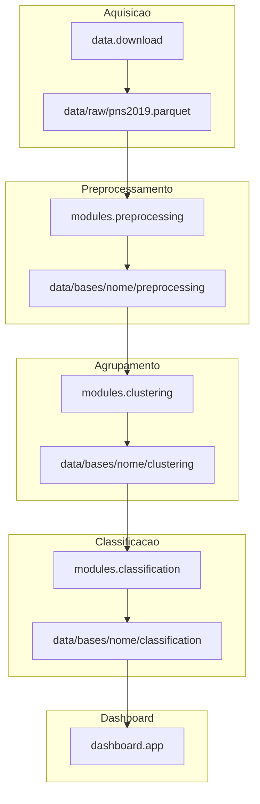
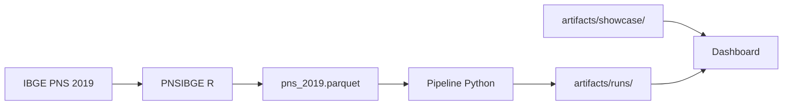
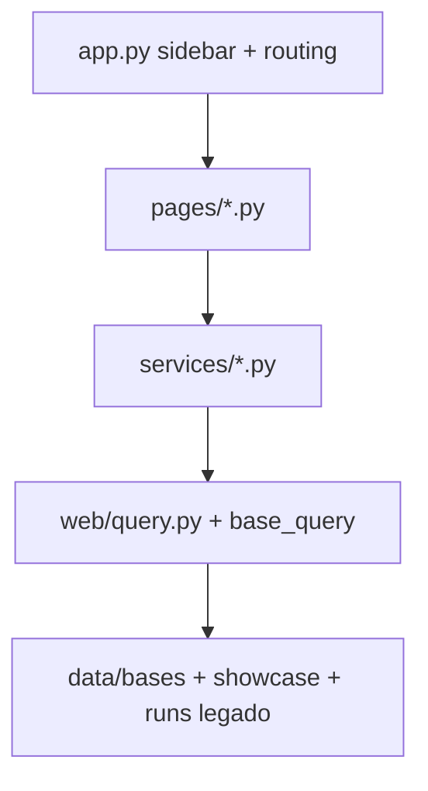

# Documentação técnica — PNS Health Research Lab

Referência para entender **o que foi implementado**, **como os módulos se conectam** e **quais fórmulas são usadas**. Para comandos rápidos, veja [README.md](../README.md). Para o histórico experimental e números oficiais, veja [trajetoria.md](trajetoria.md). Índice geral: [docs/README.md](README.md).

---

## 1. Visão geral da pesquisa

A hipótese operacional é que perfis de saúde (comorbidades agrupadas) e covariáveis demográficas ajudam a **prever o uso de serviços de saúde** na PNS 2019. O pipeline separa quatro preocupações:

| Fase | Módulo | Pergunta |
| --- | --- | --- |
| Aquisição | `data/` | De onde vêm os microdados? |
| Pré-processamento | `modules/preprocessing/` | Como chegamos às bases binária/categórica? |
| Agrupamento | `modules/clustering/` | Quais perfis de comorbidade existem? |
| Classificação | `modules/classification/` | Quem usa serviços de saúde? |



Pacote Python: `src/pns_health_research/`. Entrada principal: scripts em `scripts/`; CLI Typer (`python -m pns_health_research`) é shim interno.

---

## 1.5 Conceitos em linguagem acessível

Esta seção antecipa a leitura técnica. O histórico de decisões está em [trajetoria.md](trajetoria.md).

### O que estamos prevendo

O **target** é uso de serviços de saúde nos últimos 12 meses (variável PNS `J014`, renomeada `Serviço de Saúde`). Valor 1 = usou; 0 = não usou. O estágio `merge_internacao_into_servico` pode compor o target com internação (`J037`).

A pergunta do modelo não é “diagnosticar doença”, e sim estimar **probabilidade de utilização** com base em perfil observado no inquérito.

### De onde vêm os dados



| Origem | O que é | Exemplo no repo |
| --- | --- | --- |
| IBGE via PNSIBGE | Microdados brutos | `data/raw/pns_2019.parquet` (não versionado) |
| Nosso pré-processamento | Bases binária e categórica | `data/bases/<nome>/preprocessing/` |
| Nosso clustering | Coluna `Cluster` (0–5) | `tables/clustered_binary.parquet` |
| Nossos modelos | RF, MLP, XGBoost | `models/{name}/` |
| Showcase | Baseline TCC congelada | `artifacts/showcase/pesquisa-original-legacy/` |

### Por que PCA antes de K-Means

Quinze comorbidades correlacionam-se (multimorbidade). PCA comprime para 8 componentes antes do K-Means, reduzindo ruído e colinearidade. No legado: sem scaler; no default: `StandardScaler` antes do PCA.

### Target composto e clusters

- **Cluster** — perfil não supervisionado de comorbidades; entra como feature na classificação (target encoding no legado).
- **Serviço de Saúde** — desfecho supervisionado.

### `legacy_cv` vs CV aninhada

| Modo | Config | Comportamento |
|------|--------|---------------|
| Legado | `legacy_cv: true` | Reproduz validação do notebook TCC |
| Evolutivo | `legacy_cv: false` | CV aninhada (`n_splits`, `inner_test_size`) |

Não compare runs dos dois modos sem documentar a diferença.

### Pesos: `survey_weight` vs `ml_sample_weight`

- **`survey_weight`** — peso amostral PNS (`V00291` ou fórmula R legada); metadado de inferência populacional.
- **`ml_sample_weight`** — normalizado para `fit` quando `use_sample_weight_in_fit: true`.

### Por que três camadas de resultados

Ver [trajetoria.md — Quatro camadas](trajetoria.md#quatro-camadas--não-misturar-números). Números do TCC ≠ showcase ≠ bundle rigoroso ≠ runs `custom` sem análise.

---

## 2. Entrypoints e scripts

| Script | Comando exemplo | Saída principal |
|--------|-----------------|-----------------|
| `setup_env.sh` | `./scripts/setup_env.sh --acquisition` | `.venv` com `[dev,dashboard,acquisition]` |
| `run_download.sh` | `./scripts/run_download.sh --dataset pns_2019` | `data/raw/pns_2019.parquet` |
| `run_preprocess.sh` | `./scripts/run_preprocess.sh` | `data/bases/pns/preprocessing/` |
| `run_clustering.sh` | `./scripts/run_clustering.sh` | `data/bases/pns/clustering/` |
| `run_clustering.sh` | `./scripts/run_clustering.sh --name clust1` | `metrics/clustering.json`, tabelas PCA |
| `run_classification.sh` | `./scripts/run_classification.sh --profile pns` | `data/bases/pns/classification/` |
| `run_experiment.sh` | `./scripts/run_experiment.sh --profile pns` | Pipeline modular completa |
| `run_dashboard.sh` | `./scripts/run_dashboard.sh --port 8501` | Streamlit |

Flags comuns (via `_common.sh`): `--config`, `--dataset`, `--models`, `--name`, `--no-download`, `--force`.

### Primeira execução

1. `./scripts/setup_env.sh --acquisition` + `install.packages("PNSIBGE")` no R
2. `./scripts/run_download.sh`
3. `./scripts/run_experiment.sh --profile pns --download`
4. `./scripts/run_dashboard.sh` (opcional)

Sem parquet: showcase alimenta o dashboard (`./scripts/setup_env.sh` sem acquisition).

### Reprodução TCC

```bash
./scripts/run_experiment.sh --profile legacy
```

Mapa de configs: [configs/README.md](../configs/README.md).

---

## 3. Módulos

### 3.1 `config/` — loader e registries

| Arquivo | Função |
|---------|--------|
| `registry.py` | Carrega YAMLs modulares, `extends`, merge profundo |
| `models.py` | Pydantic `ExperimentConfig`, validação de estágios |

Fluxo de configuração:

1. Perfil em `configs/profiles/<perfil>.yaml` (um arquivo por perfil)
2. `profile_resolver` monta entry point efêmero por módulo (`#preprocessing`, `#clustering`, `#classification`)
3. `extends` → `configs/_internal/schema_root.yaml`; pipelines em `configs/_internal/pipelines/`
4. Filtro `--dataset` / `--models` na CLI

```yaml
# Perfil unificado (trecho — ver configs/profiles/pns.yaml)
profile: pns
modules:
  preprocessing:
    pipeline: _internal/pipelines/preprocessing/pns.yaml
```

### 3.2 `data/` — catálogo, download, fingerprint

| Arquivo | Função |
|---------|--------|
| `download.py` | `ensure_data_available` via PNSIBGE (rpy2) |
| `fingerprint.py` | SHA-256 e metadados do parquet |
| `catalog.py` | Entradas de `configs/shared/datasets.yaml` |

Validações: colunas mínimas, ano, path esperado em `data/raw/`.

### 3.3 `preprocessing/` — estágios e derivadas

Orquestração: `pipelines.py` → estágios com `enabled: true/false`.

| Estágio | Efeito |
|---------|--------|
| `select_columns` | Mapa bruto → nome interno (`datasets.yaml`) |
| `adult_filter` | `min_age: 18` |
| `derive_features` | Registry `derived.py` |
| `merge_internacao_into_servico` | Target composto |
| `one_hot_and_numeric` | Demografia, limitações |
| `impute_missing` | Binário 0 / categórico -1 |
| `impute_age_by_target` | Legado (vazamento) |
| `nearmiss` | Undersampling legado |
| `target_encoding_before_split` | Encoding pré-split (vazamento) |

**Derivadas** (`derived.py`): `imc`, `faixas_idade`, `grupos_comorbidade` — ligadas por `derived.<chave>.enabled` no YAML.

Artefatos de visualização: `viz_artifacts.py` → `preprocess_funnel.json`, `dataset_distributions.json`, `survey_snapshot.json`.

#### Pipeline de pré-processamento (schema 3.0)

Orquestração modular em `preprocessing/stages/registry.py` + `pipeline_runner.py`. O YAML define a ordem em `pipeline: [{id, enabled, params}]`.

| Estágio | Função |
|---------|--------|
| `select_columns` | Mapa PNS → nomes internos (`datasets.yaml`) |
| `adult_filter` | Filtro etário + IMC opcional |
| `encode_binary` | Sim/Não, comorbidades, serviços J/K/H |
| `gestational_reinforce` | Fusão gestacional + imputação de idade (opcional) |
| `attach_weights` | Peso amostral (`V00291` ou fórmula legada) |
| `drop_design_columns` | Remove colunas de desenho amostral |
| `derive_binary` | One-hot demográfico + `derived.*` (IMC, faixas, grupos) |
| `encode_categorical` | Encoding ordinal/categórico |
| `build_targets` | `servico_j014` / `servico_composto` (perfil valid) |
| `missing_audit` | Auditoria PRE-01 |
| `impute_missing` | Preenchimento final de NA |
| `finalize_outputs` | Seleção numérica das bases de saída |

Pipelines: `configs/_internal/pipelines/preprocessing/pns.yaml` (rigoroso) e `legacy.yaml` (TCC). Perfis: `configs/profiles/pns.yaml` e `legacy.yaml`.

Toggles `stages.nearmiss` e `stages.target_encoding_before_split` permanecem no YAML para a **classificação** legada; não são estágios do pipeline de preprocess.

#### Módulo independente de pré-processamento

```bash
./scripts/run_preprocess.sh --profile pns      # preset rigoroso
./scripts/run_preprocess.sh --profile legacy   # preset TCC
./scripts/run_preprocess.sh                    # default = pns
./scripts/run_clustering.sh                    # lê preprocessing/, grava clustering/
python -m pns_health_research data bases list
```

- **Base nomeada:** `data/bases/<nome>/` com `registry.json` (última execução, `run_count`, `profile_kind`)
- **Sobrescrita:** mesmo `--name` sobrescreve só o módulo executado (`preprocessing/` ou `clustering/`)
- **Presets:** `--profile pns|legacy` ou `--config` + `--name` para perfil custom (`profile_kind: custom`)
- **Perfis YAML:** `configs/profiles/` (overrides em `configs/overrides/`)
- **Pipeline plugável:** preprocess schema 3.0, clustering schema 2.0

#### Perfil `pns` (schema 3.0)

Config: `configs/profiles/pns.yaml` (módulo preprocessing).

| Aspecto | Comportamento |
|---------|---------------|
| `binary_encoding.policy` | `explicit_missing` — comorbidades NA → `-1` (não → `0`) |
| `weights.legacy_formula` | `false` — usa `V00291` (`Peso Amostral`) |
| `target.columns` | `servico_j014` (J014) e `servico_composto` (J014 ∨ internação) |
| `impute_age_by_target` | `false` |
| Saída | `data/bases/<nome>/preprocessing/` via `data prepare` |

Contrato da base (`persistence/base_store.py`):

```
data/bases/pns/
├── registry.json
├── base_manifest.json
├── preprocessing/
│   ├── binary.parquet
│   ├── categorical.parquet
│   ├── manifest.json
│   └── ...
└── clustering/
    ├── clustered_binary.parquet
    ├── clustered_categorical.parquet
    └── ...
```

Comando: `./scripts/run_preprocess.sh --profile pns` (ou `./scripts/run_preprocess.sh` — default)

Mitigações PRE-* no perfil `pns`: [trajetoria.md §2.1](trajetoria.md#21-decisões-legacy-vs-pns-justificativas).

### 3.4 `dimensionality/` e `clustering/`

Pipeline modular schema 2.0: `clustering/stages/registry.py` + `clustering/pipeline_runner.py`.

| Estágio | Função |
|---------|--------|
| `load_preprocessing` | Lê `data/bases/<source_base>/preprocessing/` |
| `select_features` | Colunas de comorbidade |
| `pca_reducer` | PCA + scaler (enable/disable) |
| `elbow_selection` | Seleção de k (opcional) |
| `kmeans_estimator` | `@register_clusterer` — hoje só `kmeans` |
| `attach_cluster_labels` | Coluna `Cluster` |
| `evaluate_metrics` | silhouette, WCSS, etc. |
| `finalize_outputs` | Parquets e métricas finais |

Config: `configs/profiles/pns.yaml` ou `legacy.yaml` (módulo clustering).

```bash
./scripts/run_clustering.sh --profile pns      # lê pns/preprocessing/
./scripts/run_clustering.sh --profile legacy   # lê legacy/preprocessing/ (TCC)
./scripts/run_clustering.sh                    # default = pns
```

| Preset | Base | `source_base` | Diferença metodológica |
|--------|------|---------------|------------------------|
| `pns` | `pns` | `pns` | PCA com scaler (`apply_scaler: true`) |
| `legacy` | `legacy` | `legacy` | TCC: sem scaler, k=6 fixo |
| custom | qualquer | `--source-base` ou YAML | `profile_kind: custom` |

Saída: `data/bases/<nome>/clustering/` com `manifest.json` (schema 2), `fingerprint.json`, `provenance.json`, `metrics/clustering.json`.

```bash
./scripts/run_clustering.sh --name pns
```

- **PCA** — `n_components: 8` (default)
- **K-Means** — `registry.py` com `@register_clusterer`
- **Seleção de k** — `selection_method: fixed | elbow | kneedle`

Backend opcional: `clustering.backend: cuml` (extra `[gpu]` — não comparável ao TCC).

### 3.5 `classification/` — modelos e validação

| Arquivo | Função |
|---------|--------|
| `pipeline_runner.py` | Orquestrador modular — lê `data/bases/<source_base>/clustering/` |
| `cv_routing.py` | Roteamento `legacy_cv` / `research_v2` |
| `registry.py` | `@register_classifier` — RF, SVC, MLP, XGBoost |
| `gridsearch.py` | Grid sobre `param_grid` inline em `models.yaml` |
| `metrics.py` | Métricas binárias (macro, weighted, `f1_positive`) |
| `curve_artifacts.py` | ROC, PR, calibração |
| `importance.py` | Feature importance, permutation |
| `persistence.py` | Salva modelos e agregados |

Perfis: `configs/profiles/pns.yaml` e `legacy.yaml` (overrides em `configs/overrides/`).

```bash
./scripts/run_classification.sh --profile pns      # lê pns/clustering/
./scripts/run_classification.sh --profile legacy   # TCC (legacy_cv)
./scripts/run_classification.sh                    # default = pns
```

| Preset | Base | `source_base` | Protocolo CV |
|--------|------|---------------|--------------|
| `pns` | `pns` | `pns` | `research_v2` (`legacy_cv: false`) |
| `legacy` | `legacy` | `legacy` | `legacy_cv: true` (TCC) |
| custom | qualquer | `--source-base` ou YAML | definido no YAML |

Saída: `data/bases/<nome>/classification/` com `manifest.json` (schema 2), `metrics/classification.json`, `models/`, `predictions/`.

GPU: `classification/gpu/` — backend alternativo; preset legacy usa `device: cpu` por default (CUDA opcional no YAML).

### 3.6 `statistics/` — inferência

Qui-quadrado, Cramér's V, intervalos de confiança bootstrap — estágio `statistics` no runner quando `enabled: true`.

### 3.7 `persistence/` — bases modulares

O runner monolítico (`ExperimentRunner`) foi removido. Cada módulo grava em `data/bases/<nome>/` via `base_store.py` e presets em `persistence/*_presets.py`.

### 3.8 `persistence/` — contrato de runs

| Arquivo | Função |
|---------|--------|
| `run_contract.py` | Manifest v2, summary, lineage, artifacts_status |
| `run_registry.py` | Lista runs completas para dashboard |
| `showcase.py` | Cópia curada para `artifacts/showcase/` |
| `baselines.py` | Comparação com tolerâncias |
| `artifact_store.py` | I/O JSON/parquet na run |

### 3.9 `dashboard/` — Streamlit

Arquitetura em camadas:

```
pages/ → services/ → query (parquet/json) → artifacts/
components/ — charts, filters, KPIs
content/ — pt_br, chart_help, value_labels
insights/ — regras automáticas
```

Páginas: Visão geral, Dataset, Agrupamento, Classificação, Comparar, Evolução, Research.

Overrides: `configs/dashboard/run_overrides.yaml`. Inventário: [dashboard/chart_inventory.md](dashboard/chart_inventory.md).

### Extensibilidade

- **Novo classificador:** `@register_classifier` + entrada em `configs/shared/models.yaml`
- **Novo clusterer:** `@register_clusterer` + `estimator.name` em `clustering.yaml`
- **Nova derivada:** função em `derived.py` + `derived.<chave>.enabled`
- **Nova edição PNS:** entrada em `configs/shared/datasets.yaml`

---

## 4. Fórmulas e métricas

### 4.1 Clustering

**Silhouette** (por amostra \(i\)):

\[
s(i) = \frac{b(i) - a(i)}{\max\{a(i), b(i)\}}
\]

onde \(a(i)\) é a distância média intra-cluster e \(b(i)\) a menor distância média a outro cluster. Implementação: `sklearn.metrics.silhouette_score`.

**WCSS** (inertia K-Means):

\[
\text{WCSS} = \sum_{k=1}^{K} \sum_{x \in C_k} \|x - \mu_k\|^2
\]

**Davies-Bouldin** e **Calinski-Harabasz** — calculados em `clustering/evaluation.py` quando \(K>1\).

### 4.2 Classificação (binária)

| Métrica | Fórmula / definição |
|---------|---------------------|
| Accuracy | \((TP + TN) / (TP + TN + FP + FN)\) |
| Precision+ | \(TP / (TP + FP)\) |
| Recall+ (sensitivity) | \(TP / (TP + FN)\) |
| F1+ | \(2 \cdot \frac{\text{precision} \cdot \text{recall}}{\text{precision} + \text{recall}}\) |
| F1 macro | Média não ponderada de F1 por classe |

**Métrica primária do dashboard:** `evaluation.primary_metric` → `f1_positive` (classe “usou serviço”).

Curvas: ROC-AUC, PR-AUC, Brier — em `curve_artifacts.py`.

### 4.3 Peso amostral

- **Legado (`legacy_formula: true`):** fórmula R do TCC aplicada no pré-processamento
- **Default (`legacy_formula: false`):** coluna `V00291` → `survey_weight`

Normalização para ML: `ml_sample_weight` derivado na pipeline de classificação quando habilitado.

---

## 5. Configurações principais

Mapa completo: **[configs/README.md](../configs/README.md)**.

```
configs/
├── profiles/             # pns.yaml, legacy.yaml (--profile)
├── overrides/            # diffs sobre um perfil
├── shared/               # datasets.yaml, models.yaml
├── _internal/            # pipelines, schema_root, tcc_overlay
└── dashboard/            # overrides do dashboard
```

### 5.1 Perfis (`configs/profiles/`)

| Perfil | Arquivo | Metodologia |
|--------|---------|-------------|
| `pns` | `profiles/pns.yaml` | Rigoroso; `device: auto`, GPU quando disponível |
| `legacy` | `profiles/legacy.yaml` | TCC; sempre CPU/sklearn |

Presets resolvidos em `src/pns_health_research/persistence/*_presets.py` via `profile_resolver.py`.

### 5.2 Pipelines internos (`configs/_internal/pipelines/`)

| Módulo | pns | legacy |
|--------|-----|--------|
| Pré-processamento | `preprocessing/pns.yaml` (schema 3.0) | `preprocessing/legacy.yaml` |
| Agrupamento | `clustering/pns.yaml` (schema 2.0) | `clustering/legacy.yaml` |

### 5.3 `configs/shared/datasets.yaml`

Entrada `pns_2019`: mapa de colunas PNS → nomes internos, `survey_weight_column: V00291`, paths de download.

### 5.4 `configs/shared/models.yaml`

Modelos com `enabled`, `param_grid` inline, `defaults.gridsearch`.

### 5.5 Legado TCC (`configs/_internal/`)

| Arquivo | Uso |
|---------|-----|
| `schema_root.yaml` | Raiz do `extends` (não usar como entry point) |
| `tcc_overlay.yaml` | Tolerâncias TCC — regressão e showcase |

### 5.6 Dados auxiliares (não experimento)

| Arquivo | Uso |
|---------|-----|
| `configs/data/dictionary.yaml` | Dicionário PNS no dashboard |
| `configs/data/survey_metadata.yaml` | Metadados do inquérito |
| `configs/dashboard/run_overrides.yaml` | Labels e ordem de exibição |

---

## 6. Dados

| Pasta | Conteúdo | Versionado |
|-------|----------|------------|
| `data/raw/` | Parquet PNS | Não (`.gitkeep`) |
| `data/interim/` | Fingerprints | Não |
| `data/bases/` | Bases modulares (`pns`, `legacy`, custom) | README versionado; parquets locais |

Download: explícito (`run_download.sh`) ou `if_missing: true` no experimento. Backend 2019: PNSIBGE via R + rpy2.

---

## 7. Artefatos e reprodução

### Árvore padrão (bases modulares)

```
data/bases/<nome>/
├── registry.json
├── preprocessing/
│   ├── binary.parquet
│   ├── categorical.parquet
│   ├── metrics/preprocessing.json
│   └── manifest.json
├── clustering/
│   ├── tables/*.parquet
│   ├── metrics/clustering.json
│   └── manifest.json
└── classification/
    ├── models/
    ├── metrics/classification.json
    └── manifest.json
```

### Layout legado (runs monolíticas — deprecado)

```
artifacts/runs/<run_id>/
├── manifest.json              # schema_version: 2
├── summary.json
├── config.resolved.yaml
├── data_fingerprint.json
├── reproduction_report.json   # se baseline.enabled
├── logs/run.log
├── metrics/
│   ├── classification.json
│   ├── clustering.json
│   ├── preprocessing.json
│   ├── preprocess_funnel.json
│   └── ...
├── tables/
│   ├── cluster_profiles.parquet
│   ├── pca_scatter_sample.parquet
│   └── ...
├── models/
│   └── {mlp,xgboost,random_forest}/
└── predictions/
```

### `manifest.json` (v2)

Campos principais: `run_id`, `name`, `profile`, `type`, `status`, `lineage`, `config_hash`, `git_commit`, `artifacts_status`.

### `reproduction_report.json`

Lista de `checks` com `expected`, `actual`, `tolerance`, `status` (PASS/FAIL). Gerado por `experiments/reproduction.py` quando `baseline.enabled: true`.

### Showcase

`artifacts/showcase/pesquisa-original-legacy/` — baseline commitada; `showcase_meta.json` liga ao `source_run_id`.

---

## 8. Dashboard (Streamlit)

```bash
./scripts/run_dashboard.sh
# http://127.0.0.1:8501
```

### Arquitetura



### Runs visíveis

Bases modulares completas em `data/bases/` + showcases em `artifacts/showcase/` + runs legadas em `artifacts/runs/` (se existirem). Overrides de exibição: `configs/dashboard/run_overrides.yaml`.

### Componentes UX

| Componente | Arquivo |
|------------|---------|
| Textos pt-BR | `content/pt_br.py` |
| Ajuda por gráfico | `content/chart_help.py` |
| Bloco padrão | `components/chart_block.py` |
| KPIs | `components/kpi_cards.py` |

Detalhamento gráfico: [dashboard/chart_inventory.md](dashboard/chart_inventory.md).

---

## 9. Testes

```bash
source .venv/bin/activate
ruff check src tests
pytest tests/ -m "not gpu" -q
```

| Marcador | Uso |
|----------|-----|
| `regression` | Exige parquet PNS real |
| `gpu` | Extra `[gpu]`, CUDA |
| (default) | Unitários + smoke de scripts |

`tests/unit/test_scripts_help.py` — scripts respondem `--help`.

---

## 10. Decisões de arquitetura

| Decisão | Rationale |
|---------|-----------|
| Python principal; R isolado | PNSIBGE só em `[acquisition]` via rpy2 |
| Artefatos em filesystem | Sem banco; runs portáveis |
| Scripts como interface | Onboarding simples; Typer interno |
| Um YAML por módulo | Diff claro; overlay `extends` para legado |
| `survey_weight` ≠ `ml_sample_weight` | Desenho amostral vs otimização ML |
| Showcase versionada | Dashboard sem download de 90k+ linhas |
| SVC `enabled: false` | Foco nos três modelos do showcase; SVC no contrato legado |

---

## Apêndice A — Contrato `artifacts/runs/`

### Status de run

`created` → `running` → `completed` | `failed` | `cancelled`

### `summary.json`

Agregado rápido: `dataset.rows`, `clustering.silhouette`, `primary_metric` (nome, valor, modelo), `models[]`.

### `artifacts_status`

Mapa de arquivos obrigatórios vs presentes — validado por `validate_required_artifacts()`.

### Lineage

```json
{
  "dataset": { "source": "pns_2019", "year": 2019 },
  "preprocessing_run_id": null,
  "clustering": { "used": true, "run_id": null }
}
```

### Comparação de runs

- Dashboard → **Evolução** — F1+ entre runs
- Dashboard → **Comparar** — agrupamento/classificação lado a lado
- Pipeline modular: `./scripts/run_experiment.sh` (default `--profile pns`)

---

## Apêndice B — Referências cruzadas

| Tópico | Documento |
|--------|-----------|
| Números oficiais TCC vs showcase | [trajetoria.md Parte 4](trajetoria.md#parte-4--resultados-consolidados-showcase-legado) |
| Bibliografia e notas | [referencias/](referencias/) |
| Monografia PDF | [research/monografia.pdf](research/monografia.pdf) |
| Tolerâncias baseline | `configs/_internal/tcc_overlay.yaml` |
