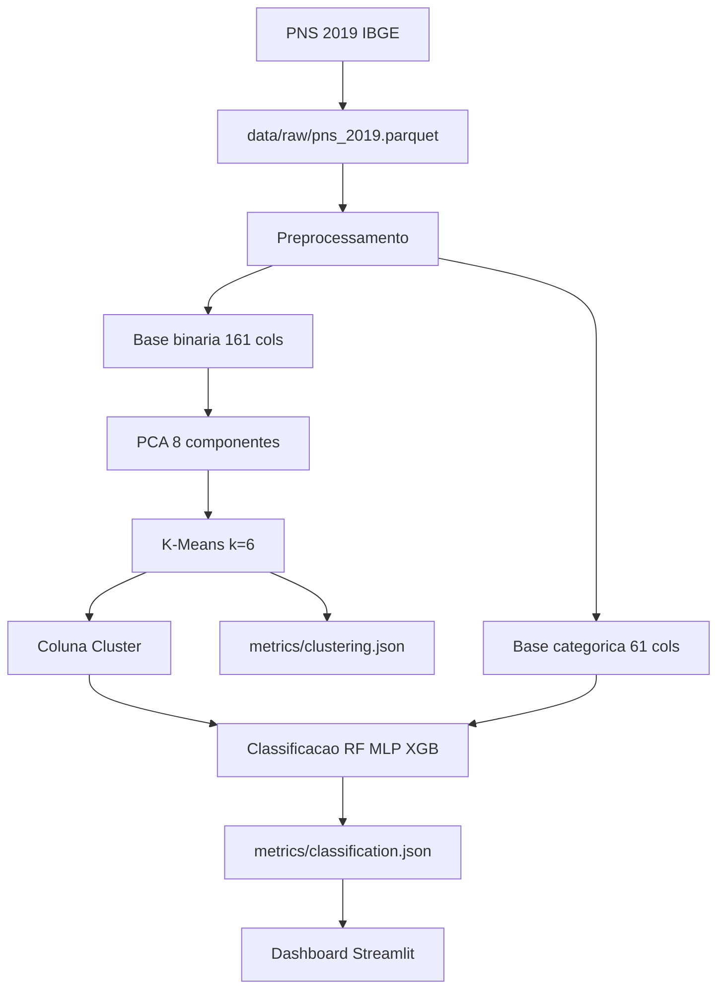

# Trajetória experimental — PNS Health Research Lab

**Documento único da pesquisa.** Narrativa metodológica: por que cada decisão foi tomada, o que comparamos, o que respondemos e o que permanece em aberto. Números oficiais na **Parte 4**; fórmulas e módulos em [documentacao.md](documentacao.md); referências em [referencias/](referencias/). Monografia (TCC): [research/monografia.pdf](research/monografia.pdf).

---

## Quatro camadas — não misturar números

| Camada | O que é | Onde ver números |
|--------|---------|------------------|
| **1. Monografia (TCC)** | Trabalho original UFOP (2025), notebooks R + Python | Tabelas do TCC; [nota](referencias/notas/monografia_tcc.md) |
| **2. Reprodução modular (`--profile legacy`)** | Software espelhando o TCC em bases nomeadas | `data/bases/legacy/` |
| **3. Dataset rigoroso (`--profile pns`)** | Pré-processamento modular (schema 3.0, pipeline por estágios); targets duais; ausentes explícitos | `data/bases/pns/` |
| **4. Bases modulares versionadas** | Saída por estágio com manifests; substitui runs monolíticas | `data/bases/<nome>/` |

Métricas da camada 2 **não substituem** as da camada 1 sem análise. O bundle da camada 3 **não** deve ser comparado numericamente ao TCC sem ler a **Parte 2.1** (decisões legacy vs pns). Bases da camada 4 **não** devem ser comparadas ao showcase sem documentar o protocolo modular.

---

## Como ler este documento

| Parte | Conteúdo |
|-------|----------|
| **0** | Problema, hipóteses H1–H3, subobjetivos SO1–SO10, referências de base |
| **1** | Metodologia conceitual — target, comorbidades, PCA, K-Means, validação |
| **2** | Protocolo, camadas de validade, tolerâncias do baseline |
| **3** | Fases F0–F3 — processo, decisões, transições |
| **4** | **Resultados consolidados** (números oficiais da reprodução) |
| **5** | O que foi e não foi tratado |
| **6** | Próximo ciclo — perguntas para mestrado |
| **Apêndices** | Glossário, direcionamento TCC, artefatos, bibliografia |

---

# Parte 0 — Enquadramento da pesquisa

## Em uma frase

Segmentar perfis de saúde a partir de comorbidades na PNS 2019 (PCA + K-Means) e **prever o uso de serviços de saúde** com modelos de aprendizado de máquina, reproduzindo o TCC e evoluindo o pipeline em plataforma reproduzível.

## Problema de pesquisa

O SUS enfrenta demanda crescente, prevalência de DCNT e envelhecimento populacional. Gestores carecem de ferramentas que antecipem **quem** tende a utilizar serviços de saúde, com base em características demográficas, clínicas e comportamentais observáveis em inquéritos nacionais (IBGE, 2020).

A pergunta do TCC que orienta este lab:

> Como desenvolver um modelo preditivo eficiente para identificar padrões de uso dos serviços de saúde com base nas características demográficas, socioeconômicas e de saúde da população brasileira?

## 0.1 Ancoragem teórica

| Teoria / linha | Referência | O que sustenta no lab | O que **não** afirmamos |
|----------------|------------|----------------------|-------------------------|
| Utilização de serviços × fatores populacionais | ERICA trends; monografia | Variável-alvo e relevância do desfecho | Causalidade individual garantida |
| Multimorbidade e DCNT | ERICA NCD; prevalência PNS | 15 comorbidades no clustering | Clusters = diagnósticos clínicos |
| ML em saúde pública | Monografia; Topol (citado no TCC) | RF, MLP, XGBoost como candidatos | Modelo pronto para implantação clínica |
| Desbalanceamento de classes | Mani & Zhang; NearMiss | Estágio legado documentado | NearMiss no default evolutivo |
| Pesos amostrais PNS | Barros & Victora; IBGE | `V00291` na camada 3 | Mesma fórmula R do TCC em todas as runs |

## Objetivo geral

Desenvolver e validar, sobre microdados da PNS 2019, um pipeline que **agrupa perfis de saúde** e **classifica o uso de serviços de saúde**, com reprodução auditável do TCC e extensão configurável via YAML.

## Perguntas e hipóteses

### Pergunta principal (QP1) → H1

Perfis de saúde derivados de comorbidades (clusters) e demais covariáveis **associam-se** ao uso de serviços de saúde de forma preditiva acima do acaso?

**H1:** modelos supervisionados (RF, MLP, XGBoost) atingem desempenho estável (F1 macro ≈ 0,78 no TCC) quando treinados com o protocolo legado; a inclusão do cluster melhora a interpretação dos perfis de demanda.

### Perguntas secundárias

| ID | Pergunta | Hipótese | Status |
|----|----------|----------|--------|
| QP2 | k=6 é estável sob PCA=8? | **H2** — silhouette > 0,5 | Confirmada no TCC e showcase (PASS) |
| QP3 | XGBoost supera RF/MLP? | **H3** — melhor F1 no TCC | Confirmada na monografia; showcase XGBoost F1+ = 0,792 |
| QP4 | Remover leakage melhora validade externa? | Extensão F2 | Parcial — default evolutivo implementado; comparação formal pendente |

### Pergunta empírica central (reprodução)

**O software reproduz dimensões e clustering do TCC dentro das tolerâncias?** — medida por `reproduction_report.json` no showcase.

## Subobjetivos operacionais

| Subobjetivo | Pergunta operacional | Saída esperada | Status |
|-------------|---------------------|----------------|--------|
| SO1 — coleta | PNS 2019 baixa e valida? | `data/raw/pns_2019.parquet` + fingerprint | Executado |
| SO2 — pré-processamento | 87.678 × 161/61 como no TCC? | `metrics/preprocessing.json` | PASS no showcase |
| SO3 — agrupamento | Silhouette ≈ 0,5139 com k=6? | `metrics/clustering.json` | PASS (Δ = −0,0012) |
| SO4 — classificação | Métricas dentro de ±0,01? | `metrics/classification.json` | **FAIL** — métricas acima do TCC |
| SO5 — transparência | Três camadas distinguíveis? | Este documento | Executado |
| SO6 — plataforma | Bases modulares + scripts `run_*`? | `data/bases/`, `run_experiment.sh` | Executado |
| SO7 — configs | Entry points por perfil e módulo? | `configs/profiles/`, `configs/README.md` | Executado |
| SO8 — evolutivo | Pipeline sem leakage por default? | `--profile pns` | Executado |
| SO9 — literatura | Decisões ancoradas? | `referencias/` | Executado |
| SO10 — showcase | Clone sem reexecução? | `artifacts/showcase/` | Executado |

## 0.2 Matriz de ancoragem bibliográfica

| Referência | Decisão que sustenta | Justificativa | Avaliação |
|------------|---------------------|---------------|-----------|
| Santos (2025) — monografia | Pipeline completo, tolerâncias | Baseline oficial | Parcial — classificação FAIL |
| Ferreira — ERICA trends | Target uso de serviços | Desfecho de gestão | Justifica QP1 |
| Ferreira — ERICA NCD | Comorbidades | Agrupamento | Justifica 15 condições |
| Mani & Zhang / NearMiss | Undersampling legado | TCC §4.2.9 | Só em `legacy.yaml` |
| Micci-Barreca | Target encoding | TCC §4.2.7 | Vazamento documentado |
| IBGE PNS 2019 | Fonte de dados | Representatividade nacional | Executado |
| Jolliffe — PCA | Redução antes de K-Means | Alta correlação entre comorbidades | Executado |
| Rousseeuw — silhouette | Validação de clusters | Métrica do TCC | PASS no showcase |

## Mapa fase → pergunta → artefato

| Fase | Pergunta | Artefato |
|------|----------|----------|
| F0 | Notebooks TCC rodam? | Monografia + notebooks legados (histórico) |
| F1 | Software reproduz TCC? | `artifacts/showcase/pesquisa-original-legacy/` |
| F2 | Default sem leakage é melhor? | `data/bases/pns/` com `--profile pns` |
| F3 | Plataforma entrega valor? | Dashboard + manifest v2 |

---

# Parte 1 — Metodologia conceitual

## 1.1 Definições sem ambiguidade

| Termo | Definição no lab |
|-------|------------------|
| **Uso de serviços de saúde** | Variável `Serviço de Saúde` (PNS `J014`), binária; pode incluir internação (`merge_internacao_into_servico`) |
| **Comorbidade (agrupamento)** | 15 condições crônicas + flags de limitação de atividades (base binária) |
| **Cluster** | Rótulo K-Means (k=6 fixo no legado) sobre PCA de comorbidades |
| **Peso amostral (desenho)** | Coluna `V00291` → `survey_weight` — inferência populacional |
| **Peso ML** | `ml_sample_weight` — normalizado para `fit` quando `use_sample_weight_in_fit: true` |
| **Base binária** | Features 0/1 para clustering e parte da classificação |
| **Base categórica** | Variáveis ordinais/nominais para target encoding e classificação |
| **Legacy CV** | Protocolo do notebook (split fixo implícito); `legacy_cv: true` |
| **CV aninhada** | Default evolutivo; `legacy_cv: false` |

## 1.2 Pipeline em alto nível



## 1.3 Por que PCA antes de K-Means

As 15 comorbidades são correlacionadas (multimorbidade). PCA reduz redundância e estabiliza K-Means (Jolliffe & Cadima, 2016). No TCC: **8 componentes**, sem `StandardScaler`. No default evolutivo: PCA **com** scaler (`apply_scaler: true`).

## 1.4 Por que três camadas de peso e validação

- **TCC:** fórmula R customizada (`weights.legacy_formula: true`)
- **Evolutivo:** `V00291` direto — alinhado à literatura de pesos PNS
- **Classificação legada:** `use_sample_weight_in_fit: false` (como notebook); evolutivo usa peso no fit

---

# Parte 2 — Protocolo e critérios de progresso

## Seis camadas de validade

| Camada | Critério | Ferramenta |
|--------|----------|------------|
| 1. Dados | Parquet com colunas mínimas + SHA-256 | `data/fingerprint.py` |
| 2. Pré-processamento | Linhas e colunas = TCC | `reproduction_report` rows/cols |
| 3. Agrupamento | Silhouette, WCSS | Tolerâncias em `legacy.yaml` |
| 4. Classificação | Acc/Prec/Rec/F1 por modelo | ±0,01 absoluto |
| 5. Reprodução global | PASS/FAIL agregado | `reproduction_report.json` |
| 6. Interpretação | Perfis e importância | Dashboard, `cluster_profiles` |

## Tabela protocolo (reprodução legada)

| Parâmetro | Valor TCC / legado | Tolerância |
|-----------|-------------------|------------|
| Linhas | 87.678 | exato |
| Colunas binárias | 161 | — |
| Colunas categóricas | 61 | — |
| Silhouette | 0,513881 | ±0,005 absoluto |
| WCSS | 37.821,75 | ±1% relativo |
| Classificação (cada métrica) | ver `legacy.yaml` | ±0,01 absoluto |

## Estágios com implicação de vazamento (legado)

| Estágio | Risco | Default evolutivo |
|---------|-------|-------------------|
| `target_encoding_before_split` | Alto | `enabled: false` |
| `nearmiss` | Médio (antes do split) | `enabled: false` |
| `impute_age_by_target` | Médio | `enabled: false` |

Detalhes em [documentacao.md §3.3](documentacao.md#33-preprocessing--estágios-e-derivadas) e [§5](documentacao.md#5-configurações-principais).

## 2.1 Decisões legacy vs pns (justificativas)

Comparação entre `--profile legacy` (reprodução TCC em `data/bases/legacy/`) e `--profile pns` (perfil rigoroso em `data/bases/pns/`). Configuração: [`configs/profiles/legacy.yaml`](../configs/profiles/legacy.yaml) e [`configs/profiles/pns.yaml`](../configs/profiles/pns.yaml).

| Tema | Legacy (`--profile legacy`) | PNS (`--profile pns`) | Justificativa |
|------|----------------------------|----------------------|---------------|
| NA em comorbidades | codificados como 0 | `explicit_missing` → -1 | Evitar confundir ausente com “não” (PRE-01) |
| Pesos amostrais | fórmula R do TCC | coluna `V00291` | Alinhar ao desenho amostral IBGE |
| NearMiss / target encoding | disponíveis no YAML legado | desligados no pipeline | Vazamento documentado no TCC |
| Scaler no clustering | off; k=6 fixo | on (`apply_scaler: true`); research_v2 | Rigor metodológico vs reprodução |
| CV classificação | `legacy_cv: true` | `legacy_cv: false` | Protocolo research_v2 com validação aninhada |
| Métrica primária | `f1` | `f1_positive` | Desfecho binário “usou serviço de saúde” |
| Device / backend | CPU, sklearn | auto (GPU se disponível) | Legacy permanece comparável ao TCC |

**Mitigações implementadas no perfil pns (status):**

| ID | Tema | Status no perfil `pns` |
|----|------|------------------------|
| PRE-01 | NA → -1 em comorbidades | Mitigado (`binary_encoding.policy: explicit_missing`) |
| PRE-02 | Peso `V00291` | Mitigado (`weights.legacy_formula: false`) |
| PRE-07 | Imputação de idade por target | Mitigado (`impute_age_by_target: false`) |
| CLU-03 | Scaler antes do PCA | Mitigado (`reducer.apply_scaler: true`) |
| CLS-01 | CV legada com leakage | Mitigado (`legacy_cv: false`) |
| CLS-02 | NearMiss pré-split | Mitigado (estágio off no pipeline pns) |

Tratamento de ausentes na PNS: [referencias/notas/imputacao_pns.md](referencias/notas/imputacao_pns.md).

---

# Parte 3 — Trajetória por fases

## F0 — Monografia e notebooks (TCC)

### Pergunta

É possível segmentar a população e prever uso de serviços com PNS 2019?

### Base bibliográfica

Monografia; ERICA; artigos de DCNT e uso de serviços em `referencias/`.

### Entradas e decisões

- Pré-processamento em **R** (PNSIBGE, derivadas, peso, NearMiss, target encoding)
- Agrupamento e classificação em **Python** (notebooks `Agrupamento`, `Classificação`, etc.)
- Modelos: RF, SVM, MLP, XGBoost

### Resultados (oficiais — camada 1)

| Métrica | Valor |
|---------|-------|
| Silhouette | ~0,5139 |
| RF accuracy | 0,778 |
| MLP F1 macro | 0,779 |
| XGBoost F1 macro | 0,784 |
| Melhor modelo | XGBoost |

### Obtidas / não obtidas

- **Obtidas:** 6 perfis interpretáveis; modelo com ~78% acurácia
- **Não obtidas:** validação prospectiva externa; auditoria formal de leakage
- **Direcionamento:** reproduzir em software e corrigir vazamentos

---

## F1 — Reprodução no software (`legacy.yaml`)

### Pergunta

O pipeline Python reproduz o TCC dentro das tolerâncias?

### Entradas

- Overlay TCC (tolerâncias): `configs/_internal/tcc_overlay.yaml`
- Presets modulares: `configs/profiles/legacy.yaml`
- Showcase: `artifacts/showcase/pesquisa-original-legacy/`

### Resultados (camada 2 — Parte 4)

| Verificação | Status |
|-------------|--------|
| `preprocessed_rows` | **PASS** |
| `silhouette` | **PASS** |
| Classificação (12 checks RF/MLP/XGB) | **FAIL** — valores **superiores** ao TCC fora da tolerância ±0,01 |

**Interpretação:** pré-processamento e clustering alinhados; classificação do software **melhor** que o relatado no TCC (possível diferença de features completas, GPU, ou métricas agregadas). Contrato marca FAIL por design conservador.

### Obtidas / direcionamento

- **Obtidas:** baseline versionada no Git; dashboard sem R
- **Direcionamento:** F2 com protocolo sem leakage; investigar gap classificação

---

## F2 — Pipeline rigoroso e plataforma modular

### Pergunta

Um pipeline metodologicamente mais rigoroso mantém desempenho útil? A plataforma modular acelera iteração?

### Decisões vs legado

| Aspecto | Legado (`--profile legacy`) | Rigoroso (`--profile pns`) |
|---------|----------------------------|----------------------------|
| Peso | Fórmula R | `V00291` |
| NearMiss / target encoding | on | off |
| PCA scaler | off | on |
| CV | `legacy_cv: true` | aninhada (`research_v2`) |
| Sample weight no fit | off | on |
| Target | `Serviço de Saúde` | `servico_composto` / `servico_j014` |

### Entregas (F2 + F3)

- Pacotes em `src/pns_health_research/modules/`
- Scripts `run_*.sh` e orquestrador `run_experiment.sh --profile pns|legacy`
- Saída em `data/bases/<nome>/` com manifests por estágio
- Showcase commitado para onboarding sem parquet

### Resultados modulares (ver Parte 4.0)

Bases materializadas com `./scripts/run_experiment.sh --all-bases`. **Não comparar** numericamente ao showcase TCC sem análise estratificada — o protocolo modular difere do runner monolítico original.

### Obtidas / direcionamento

- **Obtidas:** experimentação via YAML organizado em `configs/`; bases `pns` e `legacy` completas
- **Pendente:** estudo formal legado vs pns pareado (mesmo seed, mesma métrica primária)

---

## F3 — Comunicação dos resultados

### Pergunta

O lab facilita comunicação e revisão dos resultados?

### Entregas

- Contrato manifest por módulo em `data/bases/`
- Dashboard e API leem bases materializadas (showcase TCC como fallback)
- Inventário de gráficos: [dashboard/chart_inventory.md](dashboard/chart_inventory.md)

### Obtidas

- Clone → `setup_env.sh` → `run_dashboard.sh` funciona sem dados (showcase)
- Documentação: [configs/README.md](../configs/README.md), [data/bases/README.md](../data/bases/README.md)

---

# Parte 4 — Resultados consolidados

## 4.0 Runs modulares (`data/bases/`)

Fonte: métricas em `data/bases/<perfil>/registry.json` após `./scripts/run_experiment.sh --profile legacy|pns`.

### Agrupamento

| Base | k | Silhouette | WCSS | Onde ler |
|------|---|------------|------|----------|
| **legacy** | 6 | 0,513 | 37.821,75 | `data/bases/legacy/clustering/metrics/clustering.json` |
| **pns** | 6 | 0,379 | 441.261,71 | `data/bases/pns/clustering/metrics/clustering.json` |

A base **legacy** modular reproduz o clustering do showcase (silhouette ≈ 0,513). A base **pns** reduz a silhueta esperadamente (scaler no PCA, features e targets distintos).

### Classificação

| Base | RF F1 macro | MLP F1 macro | XGB F1 macro | RF F1+ |
|------|-------------|--------------|--------------|--------|
| **legacy** | 0,957 | 0,955 | 0,956 | 0,935 |
| **pns** | 0,996 | 0,981 | 1,000 | 0,996 |

Métricas legacy modular **superiores** ao TCC publicado (~0,78) — não equivalem ao contrato do showcase. Interpretação: protocolo CV/features do pipeline modular ≠ notebooks do TCC.

Manifests e `entry_config_path` apontam para `configs/profiles/<perfil>.yaml#<módulo>` após run completa.

---

## 4.1 Showcase legado (camada 2 histórica)

Fonte: `artifacts/showcase/pesquisa-original-legacy/`. Perfil: `legacy_reproduction`.

## 4.2 Dimensões da base

| Dimensão | Monografia | Showcase (software) |
|----------|------------|---------------------|
| Linhas | 87.678 | 87.678 |
| Colunas binárias | 161 | 161 |
| Colunas categóricas | 61 | 61 |

## 4.3 Agrupamento

| Métrica | Esperado (TCC) | Observado | Status |
|---------|----------------|-----------|--------|
| k | 6 | 6 | — |
| Silhouette | 0,513881 | 0,512687 | PASS |
| WCSS | 37.821,75 | 37.821,75 | PASS |
| Davies-Bouldin | — | 1,379 | informativo |
| Calinski-Harabasz | — | 21.477,7 | informativo |

**Tamanhos dos clusters (software):** 7.341 · 40.569 · 11.585 · 8.523 · 8.415 · 11.245.

## 4.4 Classificação

Métricas do software (macro, salvo `f1_positive`):

| Modelo | Accuracy | Precision macro | Recall macro | F1 macro | F1+ (`f1_positive`) |
|--------|----------|-----------------|--------------|----------|----------------------|
| Random Forest | 0,801 | 0,806 | 0,801 | 0,800 | 0,786 |
| MLP | 0,802 | 0,820 | 0,802 | 0,799 | 0,776 |
| **XGBoost** | **0,808** | **0,815** | **0,808** | **0,807** | **0,792** |

Métrica primária do dashboard: `f1_positive` (classe positiva = usou serviço).

### Contrato de reprodução (`overall_status: FAIL`)

Todos os 12 checks de classificação (acc, prec, rec, f1 × 3 modelos) falharam porque o software **superou** o TCC em mais de 0,01 — não por desempenho inferior.

## 4.5 Limitações dos resultados consolidados

- Números refletem protocolo **legado** (com vazamentos documentados)
- SVC não está no showcase atual (`enabled: false` no `models.yaml`)
- GPU CUDA pode diferir do ambiente original do notebook

## 4.6 Conclusão operacional (camada 2)

O software **reproduz** dimensões e clustering do TCC. A classificação **não fecha** o contrato ±0,01 porque o desempenho observado é **maior** que o publicado — exige investigação antes de atualizar tolerâncias ou a tabela da monografia.

---

# Parte 5 — O que foi e não foi tratado

Inventário de decisões metodológicas e status de mitigação: ver **Parte 2.1** acima. Tratamento de ausentes na PNS: [referencias/notas/imputacao_pns.md](referencias/notas/imputacao_pns.md).

| Tema | Status |
|------|--------|
| Reprodução pré-processamento + clustering (legacy) | Tratado — tolerâncias em `configs/_internal/tcc_overlay.yaml` |
| Perfil rigoroso pns (PRE/CLS mitigados) | Tratado — ver Parte 2.1 |
| Reprodução classificação ±0,01 vs TCC | Não fechado (FAIL conservador no showcase) |
| Comparação formal legacy modular vs pns | Documentada (Parte 2.1); experimento pareado pendente |
| SVC no pipeline atual | Desabilitado por padrão |
| PNS 2013 | Entrada em `configs/shared/datasets.yaml`, `unsupported` |
| GPU cuML vs sklearn TCC | Documentado como não comparável |
| Validação externa (outra edição PNS) | Não executada |
| Interpretabilidade SHAP sistemática | Parcial (feature importance) |
| Inferência populacional com peso no escore | Parcial — peso no fit no perfil pns |

---

# Parte 6 — Próximo ciclo

Perguntas que podem mudar a conclusão:

1. **Por que a classificação do software supera o TCC?** — diff de features, agregação de métricas, ou ambiente GPU
2. **O default evolutivo perde quanto F1+ em troca de validade?** — experimento pareado
3. **Peso amostral no threshold de decisão** — impacto em prevalência estimada vs acurácia
4. **PNS 2013** — generalização temporal
5. **k variável (elbow)** vs k=6 fixo — estabilidade interpretativa
6. **Integração mestrado** — hipótese causal ou preditiva pura para gestão?

---

# Apêndice A — Glossário

| Termo | Significado |
|-------|-------------|
| **DCNT** | Doenças crônicas não transmissíveis |
| **PNS** | Pesquisa Nacional de Saúde (IBGE) |
| **NearMiss** | Undersampling da classe majoritária |
| **Target encoding** | Média do target por categoria (risco de leakage) |
| **F1+** | F1 da classe positiva (uso de serviço) |
| **Showcase** | Run congelada em `artifacts/showcase/` |
| **Overlay** | YAML com `extends` só com diffs |

---

# Apêndice B — Direcionamento original do TCC

Extraído da [monografia](research/monografia.pdf) (Santos, 2025):

- **Objetivo geral:** modelo preditivo de uso de serviços com PNS 2019
- **Contribuição 1:** 6 perfis via PCA + K-Means sobre comorbidades
- **Contribuição 2:** XGBoost com ~78,5% acurácia; fatores: IMC, idade, depressão, hipertensão
- **Limitações declaradas:** autorrelato, causalidade, necessidade de validação externa

Nota estruturada: [referencias/notas/monografia_tcc.md](referencias/notas/monografia_tcc.md).

---

# Apêndice C — Índice de artefatos

## Showcase (versionado)

```
artifacts/showcase/pesquisa-original-legacy/
├── manifest.json
├── summary.json
├── config.resolved.yaml
├── reproduction_report.json
├── metrics/
│   ├── classification.json
│   ├── clustering.json
│   ├── preprocessing.json
│   └── ...
├── tables/
│   ├── cluster_profiles.parquet
│   ├── pca_scatter_sample.parquet
│   └── ...
└── models/{mlp,xgboost,random_forest}/
```

## Bases modulares (`data/bases/`)

```
data/bases/<nome>/
├── registry.json
├── preprocessing/
├── clustering/
│   └── metrics/clustering.json
└── classification/
    └── metrics/classification.json
```

## Runs históricas (legado)

```
artifacts/runs/<run_id>/     # runner monolítico removido; apenas runs antigas no disco
```

---

# Apêndice D — Bibliografia comentada

| Referência | Nota |
|------------|------|
| Monografia TCC | [notas/monografia_tcc.md](referencias/notas/monografia_tcc.md) |
| ERICA trends | [notas/erica_trends_health_services.md](referencias/notas/erica_trends_health_services.md) |
| ERICA NCD | [notas/erica_prevalence_ncd.md](referencias/notas/erica_prevalence_ncd.md) |
| Undersampling | [notas/undersampling_strategies.md](referencias/notas/undersampling_strategies.md) |
| Prevalência DCNT | [notas/prevalencia_dcnt_pns.md](referencias/notas/prevalencia_dcnt_pns.md) |
| Demais PDFs locais | [referencias/README.md](referencias/README.md) |

BibTeX: [referencias/bibliografia.bib](referencias/bibliografia.bib).
